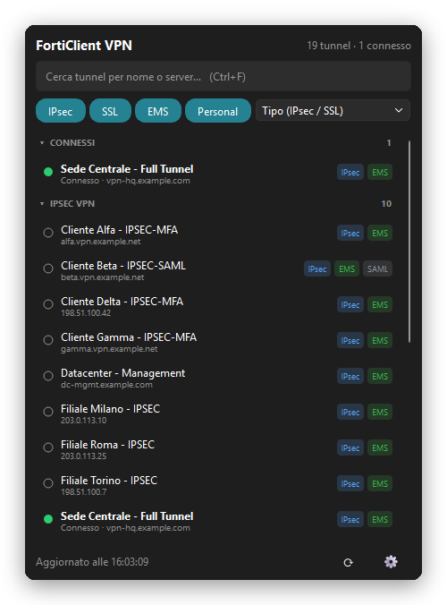
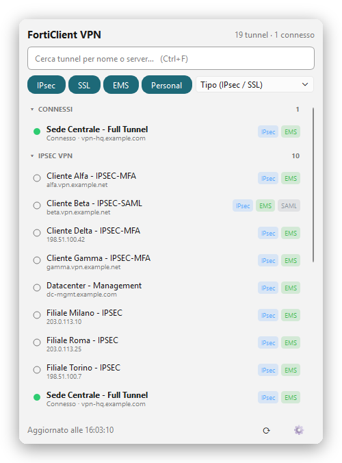
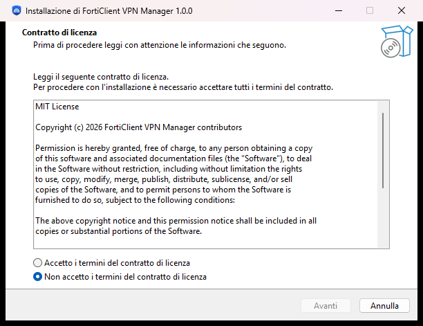
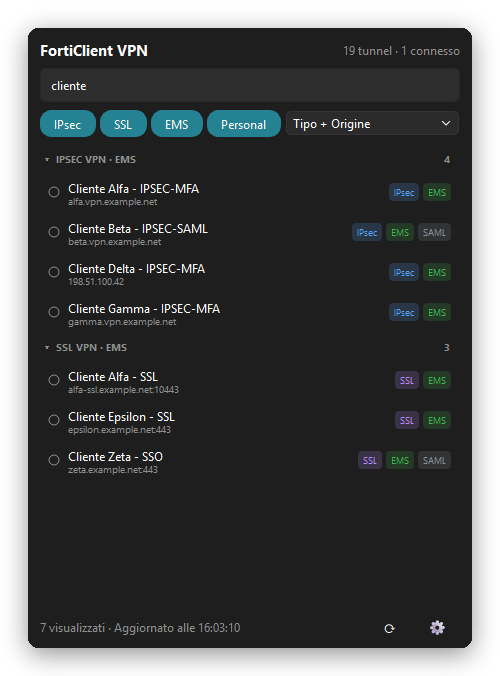
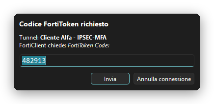

<p align="center">
  
</p>

<h1 align="center">FortiClient VPN Manager</h1>

<p align="center">
  Avvio rapido dei tunnel <b>IPsec VPN</b> e <b>SSL VPN</b> di FortiClient direttamente dalla system tray di Windows.
  <br><br>
  <a href="../../releases/latest"></a>
  <a href="../../actions/workflows/release.yml"></a>
  
  
  <a href="LICENSE"></a>
</p>

<p align="center">
  
  &nbsp;
  
</p>

> Gli screenshot usano dati dimostrativi (modalità demo): nessun tunnel reale è mostrato.

## Funzionalità

- **Tutti i profili in un clic**: elenca ogni tunnel IPsec VPN e SSL VPN installato in FortiClient,
  sia quelli distribuiti da **EMS** sia quelli **Personal** creati dall'utente.
- **Ricerca istantanea** per nome, server, tipo (`ipsec`, `ssl`), origine (`ems`, `personal`) o `saml`.
- **Raggruppamento** per Tipo, Origine, Tipo + Origine o nessun gruppo, più **filtri** rapidi IPsec · SSL · EMS · Personal.
- **Connessione con un clic, senza finestre CMD**: se FortiClient chiede password o codice FortiToken,
  compare una finestra di dialogo dell'app.
- **Stato in tempo reale**: i tunnel connessi compaiono in cima e l'icona della tray diventa verde.
- **Elenco sempre aggiornato**: le modifiche inviate da EMS e i nuovi tunnel personali compaiono da soli.
- **Aggiornamenti automatici** dall'ultima release GitHub, con installazione in un clic.
- **Installer** per utente (senza diritti di amministratore) oppure **versione portable**.
- Notifiche pop-up opzionali (disattivate di default), avvio con Windows, tema chiaro/scuro di sistema.

## Download e installazione

Scarica dall'[ultima release](../../releases/latest):

| File | Descrizione |
|---|---|
| `FortiVPNManager-Setup-x.y.z.exe` | **Consigliato.** Installer: menu Start, avvio con Windows, aggiornamenti automatici in un clic |
| `FortiVPNManager-Portable-x.y.z.exe` | Eseguibile singolo, nessuna installazione (gli aggiornamenti aprono la pagina di download) |
| `SHA256SUMS.txt` | Checksum per verificare i file |

L'installer non richiede diritti di amministratore: installa in `%LOCALAPPDATA%\Programs\FortiVPN Manager`.

<p align="center"></p>

**Requisiti:** Windows 10 (1809+) o 11 x64 · FortiClient **7.4.x**.

## Uso rapido

1. Clicca l'icona dello scudo nella system tray (eventualmente sotto la freccia `^`).
2. Scrivi parte del nome del tunnel: la lista si filtra mentre digiti.
3. Clicca il tunnel (o premi **Invio**) per connetterti. Clicca un tunnel connesso per disconnetterlo.

<p align="center">
  
  &nbsp;
  
</p>

📖 Guida completa con tutte le schermate: **[docs/GUIDA.md](docs/GUIDA.md)**

## Come funziona

L'app non modifica la configurazione di FortiClient e non salva credenziali: usa la CLI ufficiale inclusa in FortiClient.

| Funzione | Sorgente |
|---|---|
| Elenco tunnel | Registro `HKLM\SOFTWARE\Fortinet\FortiClient\{IPSec,Sslvpn}\Tunnels` (sola lettura) |
| EMS / Personal | Flag `fgt` del tunnel (`fgt=1` = configurazione distribuita da EMS/FortiGate) |
| Stato | `FortiVPN.exe --cli --status` |
| Connessione | `FortiVPN.exe --cli --connect --tunnel <nome>` eseguito in una pseudo-console invisibile (ConPTY); i prompt diventano finestre di dialogo |
| Disconnessione | `FortiVPN.exe --cli --disconnect --tunnel <nome>` |
| Aggiornamenti | API GitHub Releases di questo repository |

## Sviluppo

```powershell
python -m venv .venv
.\.venv\Scripts\pip install -r requirements-dev.txt
.\.venv\Scripts\python main.py                      # avvio da sorgente
$env:FVM_DEMO = "1"; .\.venv\Scripts\python main.py # modalità demo (tunnel fittizi)
.\.venv\Scripts\python tools\screenshots.py         # rigenera docs/images (dati demo)
.\.venv\Scripts\python tools\make_icon.py           # rigenera le icone
powershell -ExecutionPolicy Bypass -File build.ps1  # portable + installer in dist\ (richiede Inno Setup 6)
```

Struttura:

```
fortivpn_manager/
  app.py         tray, menu, polling, impostazioni, aggiornamenti
  popup.py       pannello con ricerca, filtri e gruppi
  backend.py     lettura tunnel dal registro, CLI FortiVPN
  connector.py   connessione senza finestra + gestione prompt
  conpty.py      wrapper Windows Pseudo Console
  updater.py     controllo/download aggiornamenti da GitHub
  dialogs.py     impostazioni, richiesta credenziali, aggiornamento
installer/       script Inno Setup
tools/           icone e screenshot
```

## Release

Le release sono generate da GitHub Actions ([release.yml](.github/workflows/release.yml)) per ogni tag `vX.Y.Z`:

1. aggiorna `__version__` in [`fortivpn_manager/__init__.py`](fortivpn_manager/__init__.py) e [`CHANGELOG.md`](CHANGELOG.md)
2. `git commit -am "Release vX.Y.Z"`
3. `git tag vX.Y.Z && git push origin main --tags`

Il workflow verifica che il tag coincida con la versione, compila portable e installer e pubblica la release
usando la sezione corrispondente del CHANGELOG come note. Le installazioni esistenti ricevono l'aggiornamento
automaticamente.

## Note

Progetto indipendente, non affiliato né approvato da Fortinet. FortiClient e FortiToken sono marchi di Fortinet, Inc.

Licenza: [MIT](LICENSE)
