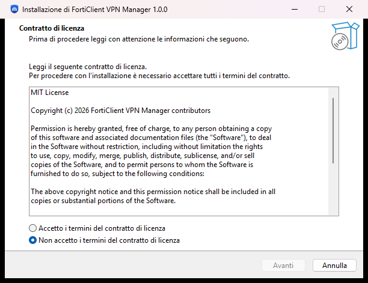
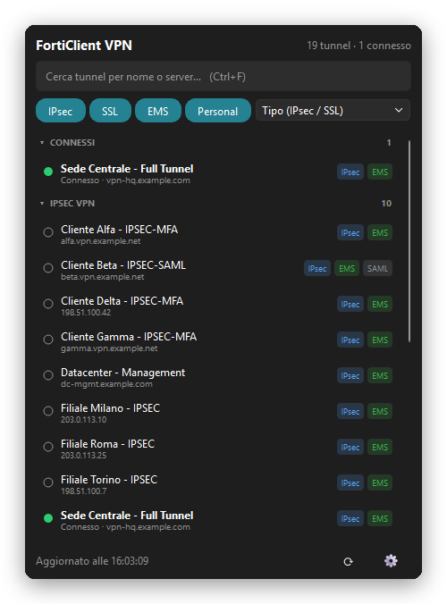
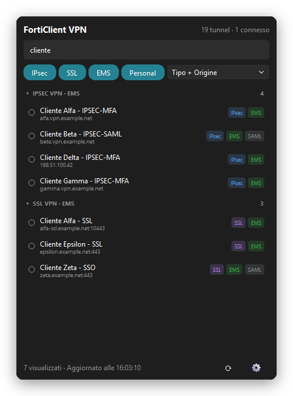
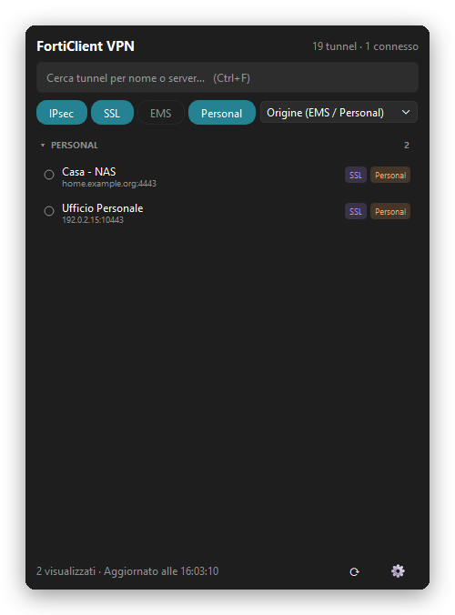
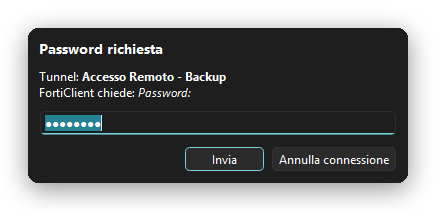
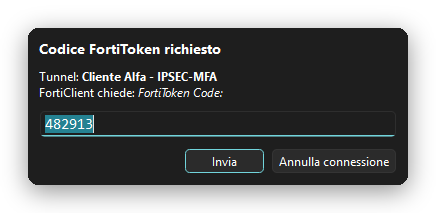
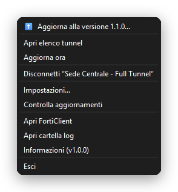
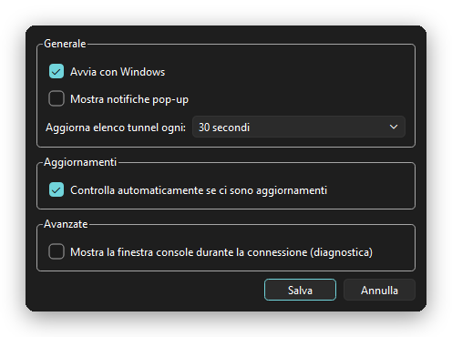
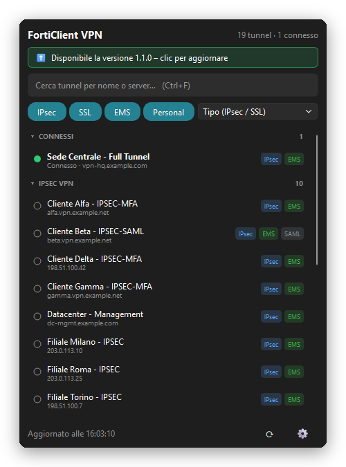
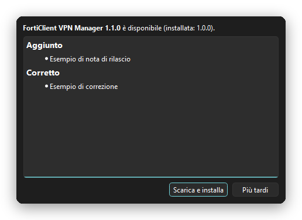

# Guida utente – FortiClient VPN Manager

> Tutte le immagini sono generate in modalità demo con tunnel fittizi.

- [Installazione](#installazione)
- [Il pannello](#il-pannello)
- [Ricerca](#ricerca)
- [Filtri e raggruppamenti](#filtri-e-raggruppamenti)
- [Connessione e disconnessione](#connessione-e-disconnessione)
- [Menu della tray](#menu-della-tray)
- [Impostazioni](#impostazioni)
- [Aggiornamenti](#aggiornamenti)
- [Scorciatoie da tastiera](#scorciatoie-da-tastiera)
- [Risoluzione problemi](#risoluzione-problemi)
- [Disinstallazione](#disinstallazione)

---

## Installazione

1. Scarica `FortiVPNManager-Setup-x.y.z.exe` dall'[ultima release](https://github.com/vischio96/Forticlient-VPN-Manager/releases/latest).
2. Avvialo e segui la procedura. Non servono diritti di amministratore.
3. Opzioni disponibili:
   - **Avvia automaticamente all'accesso a Windows** (attiva di default)
   - **Crea un'icona sul desktop**

L'app viene installata in `%LOCALAPPDATA%\Programs\FortiVPN Manager` e compare nel menu Start come
**FortiClient VPN Manager**.

**Versione portable**: `FortiVPNManager-Portable-x.y.z.exe` si avvia senza installazione. È comoda per
provare l'app, ma non si aggiorna da sola.

> Windows SmartScreen potrebbe mostrare un avviso perché l'eseguibile non è firmato digitalmente:
> scegli *Ulteriori informazioni → Esegui comunque*.

## Il pannello

Clicca l'icona nella system tray (se non la vedi, è sotto la freccia `^`; puoi trascinarla sulla barra).
L'icona ha il punto **verde** quando almeno un tunnel è connesso e **grigio** quando non ce n'è nessuno.

Ogni riga mostra:

| Elemento | Significato |
|---|---|
| ● verde | tunnel connesso |
| ● arancione | connessione in corso |
| ○ | tunnel disconnesso |
| `IPsec` / `SSL` | tipo di tunnel |
| `EMS` / `Personal` | distribuito da EMS oppure creato dall'utente in FortiClient |
| `SAML` | autenticazione SAML/SSO (si apre il browser) |

Sotto il nome compare il gateway (server). Passando il mouse su una riga vedi tutti i dettagli.

Il pannello si chiude cliccando altrove o premendo **Esc**. L'elenco si aggiorna da solo (di default ogni 30 s),
così i tunnel inviati o rimossi da EMS e quelli creati a mano compaiono senza riavviare nulla.

## Ricerca

Scrivi direttamente: la casella di ricerca ha già il focus all'apertura. Si cercano **nome**, **server**,
**tipo**, **origine** e la parola **saml**. Più parole vengono combinate (tutte devono essere presenti):

| Ricerca | Risultato |
|---|---|
| `milano` | tunnel con "milano" nel nome o nel server |
| `cliente ssl` | tunnel SSL con "cliente" nel nome |
| `personal` | solo tunnel Personal |
| `saml` | solo tunnel con autenticazione SAML |
| `203.0.113` | tunnel il cui gateway contiene quell'indirizzo |

## Filtri e raggruppamenti

I quattro pulsanti sotto la ricerca attivano o disattivano le categorie **IPsec**, **SSL**, **EMS** e **Personal**.
Il menu a tendina sceglie il raggruppamento:

- **Tipo (IPsec / SSL)**
- **Origine (EMS / Personal)**
- **Tipo + Origine** (es. *IPsec VPN · EMS*)
- **Nessun gruppo**

I gruppi si comprimono ed espandono con un clic sull'intestazione. Filtri, raggruppamento e gruppi compressi
vengono ricordati. Il gruppo **Connessi** in cima mostra sempre i tunnel attivi.

Se i filtri nascondono tutto, compare il pulsante **Reimposta filtri**.

## Connessione e disconnessione

- **Clic** su un tunnel disconnesso → connessione.
- **Clic** su un tunnel connesso → richiesta di conferma, poi disconnessione.
- **Tasto destro** → Connetti, Disconnetti, Copia nome, Copia server, Apri FortiClient.

La connessione avviene **senza aprire finestre CMD**. Se FortiClient ha bisogno di qualcosa (password
non salvata, codice FortiToken, nome utente), l'app mostra una finestra di dialogo:

 

**Annulla connessione** interrompe il tentativo. Per i tunnel SAML FortiClient apre il browser per l'accesso.
Se la connessione non riesce compare un messaggio con il motivo; in *Mostra dettagli* c'è l'output completo
di FortiClient.

Le credenziali digitate vengono passate direttamente a FortiClient: l'app non le salva e non le registra nei log.

## Menu della tray

Tasto destro sull'icona (oppure ⚙ in basso nel pannello):

| Voce | Azione |
|---|---|
| Aggiorna alla versione… | compare solo quando c'è un aggiornamento |
| Apri elenco tunnel | apre il pannello |
| Aggiorna ora | ricarica subito elenco e stato (anche **F5**) |
| Disconnetti "…" | una voce per ogni tunnel connesso |
| Impostazioni… | vedi sotto |
| Controlla aggiornamenti | verifica manuale su GitHub |
| Apri FortiClient | apre la console di FortiClient |
| Apri cartella log | `%LOCALAPPDATA%\FortiVPNManager` |
| Esci | chiude l'app (i tunnel connessi restano attivi) |

## Impostazioni

| Opzione | Default | Descrizione |
|---|---|---|
| Avvia con Windows | sì (installer) | avvia l'app all'accesso |
| Mostra notifiche pop-up | **no** | notifiche Windows per connessione/disconnessione, tunnel aggiunti/rimossi e aggiornamenti |
| Aggiorna elenco tunnel ogni | 30 s | 10 s, 30 s, 1 min o 5 min |
| Controlla automaticamente aggiornamenti | sì | all'avvio e ogni 6 ore |
| Mostra la finestra console (diagnostica) | no | usa la console di FortiVPN invece delle finestre di dialogo: utile per capire un problema di connessione |

## Aggiornamenti

Quando viene pubblicata una nuova versione su GitHub, l'app la segnala:

- un banner verde in cima al pannello;
- la voce **Aggiorna alla versione…** nel menu della tray;
- una notifica, se le notifiche pop-up sono attive.

 

Con **Scarica e installa** il nuovo setup viene scaricato e installato in modalità silenziosa; l'app si chiude
e si riapre aggiornata dopo qualche secondo. Nella versione portable il pulsante apre la pagina di download.

## Scorciatoie da tastiera

| Tasto | Azione |
|---|---|
| (digitare) | cerca, da qualsiasi punto del pannello |
| ↓ / ↑ | scorre i risultati |
| Invio | connette il tunnel selezionato (o il primo risultato) |
| Esc | cancella la ricerca; se vuota chiude il pannello |
| F5 | aggiorna elenco e stato |
| Ctrl+F | torna alla casella di ricerca |

## Risoluzione problemi

| Problema | Soluzione |
|---|---|
| "FortiClient non trovato" | FortiClient 7.4 non è installato o manca `FortiVPN.exe` nella cartella di installazione |
| Un tunnel appare come EMS ma l'hai creato tu (o viceversa) | la classificazione usa il flag `fgt` scritto da FortiClient; segnala il caso aprendo una issue |
| La connessione non parte e non compare nessuna richiesta | attiva *Impostazioni → Mostra la finestra console* e riprova: vedrai l'output di FortiClient |
| Lista vuota | controlla i filtri (pulsante **Reimposta filtri**) |
| Serve un log dettagliato | imposta la variabile d'ambiente `FVM_DEBUG=1`, riavvia l'app e apri *Apri cartella log* |

## Disinstallazione

*Impostazioni di Windows → App → App installate → FortiClient VPN Manager → Disinstalla*.
Vengono rimossi anche l'avvio automatico e il collegamento. Le preferenze restano in
`HKCU\Software\FortiVPNManager` (puoi eliminarle a mano).
